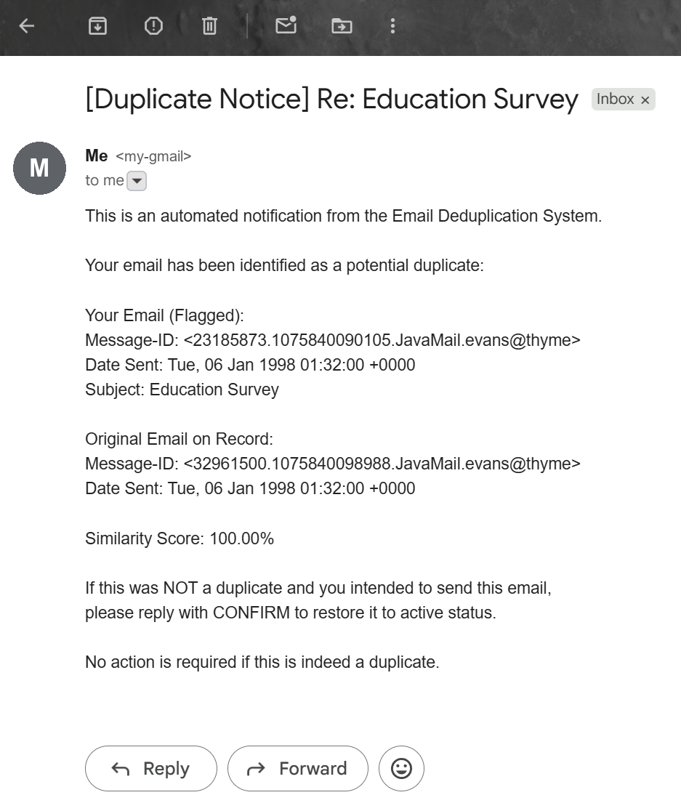

# AI Usage

How this project was built with an AI coding assistant: what I asked for, how the work was split, where the AI got things wrong and how that was caught, and how the Gmail MCP server was integrated.

The raw journal kept during the work is [`spec/AI_USAGE_LOG.md`](spec/AI_USAGE_LOG.md) (13 entries, written as things happened). This document is the summary.

---

## 1. Tool used

| | |
|---|---|
| AI coding tool | **Claude Code** 2.1.326 (CLI, Windows 11, PowerShell + Git Bash) |
| Model | Claude Opus 5.5 |
| Other | A terse "caveman" response style plugin to keep chat replies short and save context; code, commits and docs were written normally |
| MCP | GongRzhe Gmail MCP server 1.1.11, used both from the pipeline (Python MCP client) and from Claude Code directly (see section 6) |

Everything ran in one long Claude Code session working in the repository: it read and wrote files, ran Python, git and `gh`, and asked me structured questions whenever a design decision came up.

## 2. Prompting strategy

**Task by task, not the full spec at once.** My first prompt asked the AI to split the assignment document into separate markdown files (overview, rules, one file per task, the email template, deliverables) so that only the active task is in context, and to give each task an acceptance checklist. Each task then followed the same loop: load only that task's spec, build, check the output against the checklist, iterate until every box passes, mark it done, log what happened, commit, push. The tracker in [`spec/README.md`](spec/README.md) and the per-task files in [`spec/`](spec/) are the result.

**The AI asks, I decide.** I asked the AI to raise architecture questions instead of deciding alone. It turned out to work best when each question carried measured numbers from the real data, so I was choosing between concrete outcomes rather than abstractions. I made about 25 decisions this way (mailbox subset, parsing failure policies, schema normalization, the duplicate text/metric/tie-break rules, subject handling, what to commit, repo visibility).

**Profile before building.** For Task 1 and Task 3 the AI first ran throwaway scripts over the real data, then wrote the code. Parser rules and duplicate rules came from counts, not guesses.

### Example prompts

**1. Kickoff: split the spec, work task by task, keep me in the loop** (excerpt)
> "...it's going to be difficult to go again and again into the R2 - Take Home Assignment.docx file ... make multiple .md files ... I say different since once we will be done with Task 1 we don't want it to also be in the context when we work on Task 2, it will be less expensive and also more effective ... Also I want you to ask me questions so that we can decide on the technical architecture together of what we will be using and also keep myself in the loop of what we are working on."

Why: a one-day deadline with five tasks. Small per-task context keeps the AI focused and cheaper, acceptance checklists give a clear definition of done, and asking for questions keeps the architecture mine.

**2. Verify the AI's summary against the source**
> "Also check all the files that we create against the original one so that we can make sure that we don't miss anything from the original doc."

Why: a summary can silently drop requirements. The AI converted the .docx to text, split it into 148 sentences and table cells, and matched each against the spec files by token overlap. 49 were flagged below 85% coverage; 4 were real gaps (the allowed AI tool list, "representative subset / entire dataset not required", the document's goal framing, and the line "We want to understand how you collaborate with AI tools"), which were added. The rest were paraphrases.

**3. Vet an external dependency before committing to it**
> "this is what I found from my research is apparently a good open source MCP server for Gmail and specifically for Claude, https://github.com/GongRzhe/Gmail-MCP-Server.git, you can check if this is good and won't give any issues to us going forwards, or we can choose something else later on together"

Why: finding out at Task 4 that the server could not do what we needed would have cost hours. The AI checked the repo via the GitHub API (archived), read the `send_email` source and the published npm build, and checked protocol compatibility with the Python MCP SDK. Details in section 6.

**4. Move to the next task, under the agreed loop**
> "Okay let's go to the next task"

Why this short prompt worked: the workflow was already agreed, so it triggered the whole loop. For Task 3 the AI loaded only the Task 3 spec, profiled duplicate candidates under three text choices and two metrics, and came back with four questions, each with numbers. For example: comparing only the sender's own body forms 311 groups purely from two empty bodies; comparing full text lets shared quoted threads push different replies over 90%. I chose the middle option (own body, full text when empty).

**5. Prompting Claude Code to call the MCP `send_email` tool directly**
> "Use the gmail MCP server's send_email tool to send the duplicate notice in output/replies/348269.1075840857152.JavaMail.evans@thyme.eml to <my-gmail> instead of the Enron address in its To header. Keep the subject and body exactly as in the file, and pass the file's References value as inReplyTo."

Why: it points at a pipeline-generated draft, so the content is the pipeline's and not invented by the AI. It names the tool, overrides the recipient explicitly (never the Enron address), demands an exact subject and body, and maps the template's `References` header onto the tool's `inReplyTo` parameter. It worked on the first try (section 6).

## 3. Iterations and debugging

Cases where the AI's first version did not work, and how each was found and fixed.

### 3.1 Silent wrong timezone (caught by a deliberately chosen test)
- **What broke:** a unit test for a `CEST` date came back 2 hours off. Python's `email.utils.parsedate_to_datetime` does not raise on timezone abbreviations it doesn't know; it returns a naive datetime, which the AI's first parser version then labelled UTC.
- **Why it matters:** the real data rarely hits this, so the bug would have shipped silently. Only a test case picked to be awkward exposed it.
- **Fix:** naive results are re-parsed with `dateutil` and an explicit abbreviation table; a still-unknown zone fails with "unknown timezone" instead of guessing. Test kept.

### 3.2 Forwards filed as replies (caught by a random spot check)
- **What broke:** in a random 20-record spot check against the raw files, `FW: El Paso 1110` had its forwarded text in `quoted_content`, and `Fwd: Diplomatic Nominations` was not split at all. Outlook writes `-----Original Message-----` for forwards too, and AOL forwards embed raw headers with no separator line.
- **Fix:** I agreed with the AI's proposal to treat those markers as ambiguous and classify them by subject (`FW:`/`Fwd:` means forwarded, otherwise quoted). `forwarded_content` coverage went from 8.5% to 14.6%. Tests added for both shapes.

### 3.3 Headings heuristic needed two review rounds on real output
- **Round 1:** output contained file names (`<<X20292.DOC>>`), names over long separator lines read as underlined headings, and whole sentences.
- **Round 2:** the top of the list was `[IMAGE]` (365 times) and salutations (`Jeff:`, `Dear Mr. Skilling:`).
- **Fix:** underline length must be 0.5x to 1.5x of the text, skip file references, list lines, tab rows and salutations, never treat a label that opens a message as a heading, strip `[IMAGE]` first. A regression test holds every noise case. Lesson: the tests passed after round 1; only reading real output showed it was wrong.

### 3.4 The MCP server reports failures as success-shaped results
- **What the AI found:** reading the published server code (not its README), errors are returned as ordinary text (`Error: ...`) without the MCP `isError` flag. A client that trusted the flag would log failed sends as sent and mark them notified in the database, so they would never be retried.
- **Fix:** a send only counts when the reply starts with `Email sent successfully`. The tests use a stand-in MCP server that replies the same way, so this path is tested over real stdio without touching Gmail.

### Smaller ones
- The first profiling script crashed with `TypeError: argument of type 'Header' is not iterable`: the `email` package returns `Header` objects for non-ASCII header bytes. The parser now decodes headers itself.
- `Path.write_text` on Windows wrote `error_log.txt` with CRLF line endings; found at the first commit, fixed with `newline="\n"` plus `.gitattributes`.
- The first folder-priority list for the duplicate tie-break missed `_sent`, a fourth sent-folder name (261 emails). Found by listing the real folder names before running.
- The test MCP server first used `FastMCP`, which the `mcp` 2.x SDK renamed to `MCPServer`; the import error named the fix.
- The AI claimed two "Summer Interns" rows were the same email, then noticed they were 5 hours apart. It opened both raw files before keeping the claim: bodies identical, different mailboxes, and the raw Date headers themselves differ by 5 hours (a dataset artifact, now documented).
- The AI told me the 1979 placeholder date was "Unix time 0". It is `1980-01-01 00:00 UTC`, the DOS epoch. It corrected itself and the spec; the rule (treat as invalid) did not change.
- Two scripted edits went wrong (a dependency pin inserted under the wrong comment, a shell heredoc that would not parse); both caught on read-back and redone.

## 4. What I wrote vs what the AI wrote

Rough split: **about 15-20% me, 80-85% AI.**

| Me | AI |
|---|---|
| The workflow: spec split, per-task acceptance checklists, build -> check -> iterate | All Python code: about 1,670 lines in `enron_pipeline/` + `main.py` |
| Choice of MCP server (GongRzhe), found in my own research | All tests: about 720 lines, 65 tests, including the stand-in MCP server |
| Every architecture and policy decision (about 25), e.g. mailbox subset, the 4 parsing failure policies, the `addresses` table, the 4 duplicate rules, literal template subject, committing all drafts, private GitHub repo | `schema.sql` and `sample_queries.sql`, including the expected outputs measured on real data |
| Google Cloud OAuth client and the Gmail sign-in (the AI never saw the keys or token) | Data profiling and verification scripts, spot checks against raw files |
| Live-send verification: checked the inbox, the `In-Reply-To` / `References` headers, the screenshot | Reading the MCP server's source and published build; the MCP client |
| Reviewing outputs and decisions at every task boundary | First drafts of the spec files, README and this document; commit messages |

Example prompt 5 in section 2 (the `send_email` prompt) was drafted by the AI at my request and run by me in a fresh session.

## 5. Lessons learned

**What worked well**
- **Small context per task.** One spec file per task, each with a checklist, kept every session focused, and "done" was never ambiguous.
- **Decisions with numbers attached.** The AI measuring the options first ("311 groups from empty bodies", "96% of groups tie on timestamp") made each decision quick and defensible.
- **Checking against primary sources.** The most valuable catches came from going below the documentation: the raw email files (trailing dots, skewed timestamps, Bcc mirroring Cc) and the MCP server's published code (errors without `isError`, `inReplyTo` setting `References`, contrary to an open issue).
- **Tests that imitate the outside world.** The stand-in MCP server reproduces the real server's reply quirks, so the live-send logic was tested before any real email was sent.
- **Safety designed in up front.** Recipient override, refusal of dataset addresses, a send cap, and starting with `--limit 1` meant the first real send was a non-event.

**What was harder than expected**
- **The dataset.** It is messier than its reputation: filenames that Windows cannot store, placeholder dates, Bcc copied from Cc, the same email in up to five folders with timestamps hours apart.
- **Heuristics need human eyes.** Headings and body splitting both passed their tests while still being wrong on real data. Reading real output was the only check that worked.
- **Plausible but wrong.** The AI's first versions often looked right: the timezone bug, a confident claim about two emails, the "Unix time 0" slip. Verifying claims against data became a habit, not an afterthought.
- **The rule as written vs its intent.** The brief's duplicate rule also flags templated automated mail (weekly reports, reminders). I chose to keep the rule and document the limitation rather than quietly change the definition.
- **Tooling friction.** Windows shell quoting, an SDK whose API had changed since the AI's training, and an MCP server that only appears in Claude Code sessions started after it was registered.

## 6. MCP integration

### 6.1 Server chosen and why

**[GongRzhe/Gmail-MCP-Server](https://github.com/GongRzhe/Gmail-MCP-Server)**, npm `@gongrzhe/server-gmail-autoauth-mcp`, pinned to `1.1.11`.

I found it in my own research; before using it the AI vetted it:
- MIT licensed, widely used (about 1.2k stars), exposes a tool named exactly `send_email` with `to`, `subject`, `body`, `cc`, `bcc` and `inReplyTo`.
- In the published 1.1.11 build, `inReplyTo` sets both `In-Reply-To` and `References`, so the template's `References:` header is achievable. An open issue claims otherwise; the shipped code shows it works.
- Built on the MCP SDK with protocol `2024-11-05`, which the Python `mcp` 2.3.0 client still supports, so the pipeline can drive it directly.

Risks and how they were handled:
- **Archived repository:** no fixes will land. Pinned to an exact version.
- **Broad OAuth scopes** (`gmail.modify`, `gmail.settings.basic`) and 19 tools including delete and filter: the pipeline only ever calls `send_email`, and Claude Code denies the other 18 tools.
- **Open issue #96** (arrays passed as strings when called from Claude Code): watched for, did not occur.
- **Fallback** if it had failed the smoke test: a custom Python MCP server with a send-only scope. It was not needed.

### 6.2 Setup, step by step

Credentials:
1. Google Cloud Console: new project, enable the Gmail API, OAuth consent screen (External, my Gmail as a test user), OAuth client ID of type Desktop app, download the JSON.
2. Save it as `~/.gmail-mcp/gcp-oauth.keys.json`, outside the repo. Structure with redacted values: [`gcp-oauth.keys.json.example`](gcp-oauth.keys.json.example).
3. Sign in once: `npx -y @gongrzhe/server-gmail-autoauth-mcp@1.1.11 auth`, which writes `~/.gmail-mcp/credentials.json`.
4. Live recipient in `.env` (gitignored): `NOTIFY_LIVE_TO=<own address>`. Template: [`.env.example`](.env.example).
5. Optional explicit config: [`mcp_config.json.example`](mcp_config.json.example) -> `mcp_config.json` (gitignored).

The server is used in two ways:
- **From the pipeline** (`python main.py --send-live`): `enron_pipeline/notify.py` is an MCP client built on the official `mcp` Python SDK. It spawns the server over stdio, runs the handshake, checks that `send_email` is listed, and calls it once per duplicate group.
- **From Claude Code:** `claude mcp add gmail --scope local -- npx -y @gongrzhe/server-gmail-autoauth-mcp@1.1.11`, then `.claude/settings.local.json` with `permissions.deny` for the 18 non-send tools. `send_email` still asks for approval on each call. The session had to be restarted to see the new server.

### 6.3 Prompting the AI tool to use `send_email`

The verbatim prompt that sent a notification from Claude Code is example 5 in section 2. Claude Code read the draft, loaded the tool and made this call:

```
mcp__gmail__send_email(
  to=["<own address>"],
  subject="[Duplicate Notice] Re: Analyst & Associate Program - Summer Interns",
  body="This is an automated notification from the Email Deduplication System.\n\n...",
  inReplyTo="<348269.1075840857152.JavaMail.evans@thyme>")
-> Email sent successfully with ID: 1a1e7ebb98bf2fec
```

The pipeline makes the same call programmatically (`enron_pipeline/notify.py`):

```python
result = await session.call_tool("send_email", {
    "to": [recipient],
    "subject": note.subject,
    "body": note.body,
    "inReplyTo": note.references,  # server sets In-Reply-To and References
})
ok = not result.is_error and result_text.startswith("Email sent successfully")
```

How the AI was prompted to build that client: "Okay let's move to task 4". Under the agreed loop it smoke-tested first: a 15-line client that spawned the pinned server and listed its tools, before any code was written and before I had signed in.

### 6.4 Issues and how they were resolved

| # | Issue | Resolution |
|---|---|---|
| 1 | Server returns failures as plain text without `isError` | Success only on the `Email sent successfully` prefix; stand-in server reproduces it in tests (section 3.4) |
| 2 | Server starts and lists tools with no OAuth token; auth problems only show at send time | "Handshake OK" not treated as "can send"; first live run used `--limit 1` and I checked the inbox before sending more |
| 3 | `mcp` 2.x renamed `FastMCP` to `MCPServer` | Test server uses `from mcp.server.mcpserver import MCPServer` |
| 4 | Broad scopes and 19 tools including destructive ones | Pipeline calls only `send_email`; Claude Code denies the other 18 tools |
| 5 | A server added with `claude mcp add` is invisible to an already running session | Restarted the session (`claude --continue`) |
| 6 | Known issue #96 (arrays as strings from Claude Code) | Did not occur with Claude Code 2.1.326 |
| 7 | Google's "app not verified" screen for a personal OAuth client | Expected; continued via Advanced. Consent screen in testing mode with my address as test user |

### 6.5 Evidence of successful live sends

Pipeline runs `python main.py --send-live --limit 1`, then `--limit 4`: 5 attempted, 5 sent, 0 failed. Excerpt from [`output/send_log.csv`](output/send_log.csv):

```
timestamp,recipient,subject,status,error,intended_recipient,flagged_message_id
2026-11-17T04:47:57Z,<my-gmail>,[Duplicate Notice] Re: Education Survey,sent,,jan_levine@travisintl.com,<23185873.1075840090105.JavaMail.evans@thyme>
2026-11-17T04:57:41Z,<my-gmail>,[Duplicate Notice] Re: ,sent,,markskilling@hotmail.com,<16648315.1075840081609.JavaMail.evans@thyme>
```

Console output of the first run:
```
INFO enron_pipeline.notify: Live send: 1 notification(s) to <my-gmail> via MCP send_email
INFO enron_pipeline.notify: Sent notice for <23185873.1075840090105.JavaMail.evans@thyme> to <my-gmail> (intended jan_levine@travisintl.com): Email sent successfully with ID: 1a1e7d550cc0b2ba
Live sending          : attempted 1, sent 1, failed 0
```

The first notification as received in Gmail. "Show original" confirmed both `In-Reply-To` and `References` carry `<23185873.1075840090105.JavaMail.evans@thyme>`:



Plus one send prompted from Claude Code (section 6.3), server reply `Email sent successfully with ID: 1a1e7ebb98bf2fec`.
